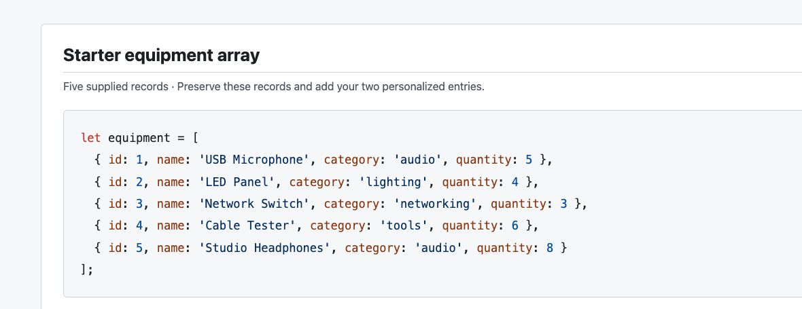
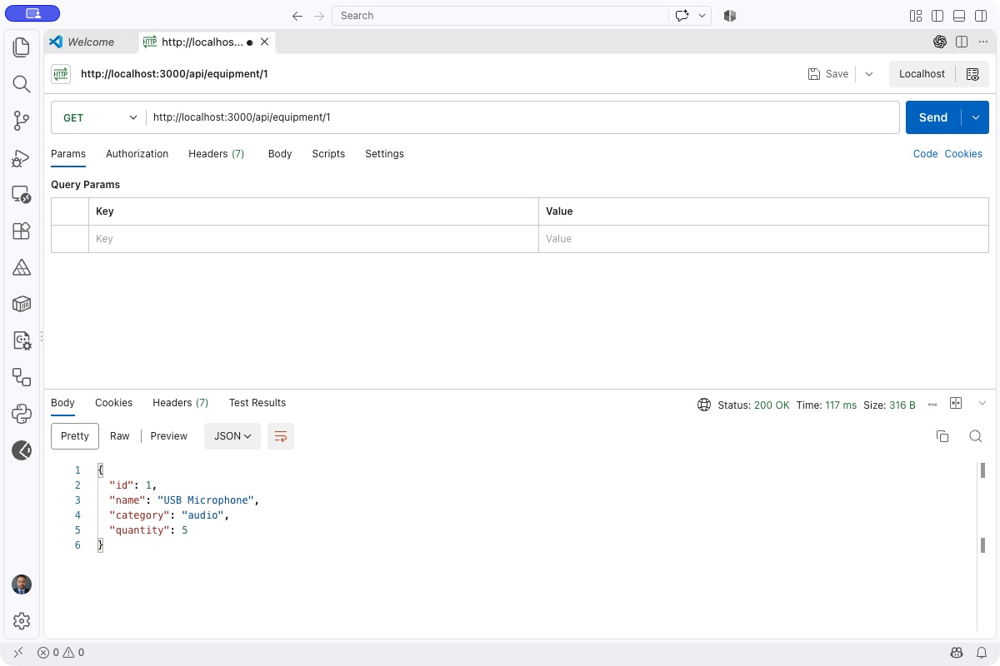
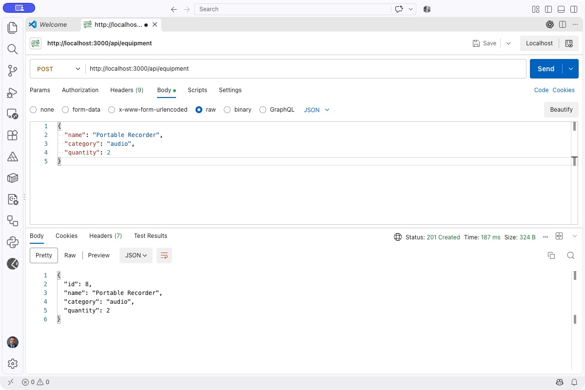

# COMP229 Midterm — Equipment Catalogue API

**Fall 2026 · Individual practical · 120 minutes · 100 marks**

## 1. Project overview

Complete a REST API that manages an equipment catalogue. An Express server and five equipment records are supplied. Add two personalized records, then implement the six unfinished endpoints in `server.js`.

All requirements are available from the start. Your work is JavaScript and Express using an in-memory array. A frontend, database, authentication, deployment, and additional packages are not required. The starter's `501 Not Implemented` responses are placeholders that you must replace.

Suggested time: 10 minutes for setup/personalization, 65 minutes for endpoints, 30 minutes for testing, and 15 minutes for packaging. Submit within the announced 120-minute window in the course's midterm submission area.

## 2. Setup and server startup

1. [Download the starter ZIP](https://github.com/CENT-COL/COMP229-F26-MIDTERM/archive/refs/heads/main.zip), extract it, and open the folder containing `package.json` in VS Code. Alternatively, clone the repository:

   ```sh
   git clone https://github.com/CENT-COL/COMP229-F26-MIDTERM.git
   cd COMP229-F26-MIDTERM
   ```
2. Use Node.js **22 or later**. In the project terminal, check and install:

   ```sh
   node --version
   npm install
   npm start
   ```

3. Visit `http://localhost:3000/` to check that the server responds. Leave the terminal running while you test with Postman (desktop or VS Code extension), Thunder Client, or another HTTP client.
4. Stop with **Ctrl+C**, then run `npm start` again after editing. There is no automatic reload.

The default port is **3000**. If occupied, stop your other development server or set the `PORT` environment variable and use that port consistently in all requests. The server listens only on your computer. No hosting is needed.

## 3. Starter array and field definitions

Preserve the five supplied records exactly. This is the array before your two personalized additions:

```js
let equipment = [
  { id: 1, name: 'USB Microphone', category: 'audio', quantity: 5 },
  { id: 2, name: 'LED Panel', category: 'lighting', quantity: 4 },
  { id: 3, name: 'Network Switch', category: 'networking', quantity: 3 },
  { id: 4, name: 'Cable Tester', category: 'tools', quantity: 6 },
  { id: 5, name: 'Studio Headphones', category: 'audio', quantity: 8 }
];
```



| Field | Meaning and rules |
|---|---|
| `id` | Unique positive integer. Initial IDs are 1–7 after personalization. API-created records receive a server-generated ID. IDs are not array indexes. |
| `name` | String containing at least one non-whitespace character. |
| `category` | String containing at least one non-whitespace character. |
| `quantity` | JSON number that is an integer greater than or equal to zero. A numeric string is invalid. |

On a successful POST or PUT, trim outer whitespace from `name` and `category`, preserve their case, and store only the four documented fields. Extra request fields, including a supplied `id`, are ignored. API-created names need not be unique. Return records as JSON objects, and lists as JSON arrays without a wrapper object. Object-key order and JSON indentation do not affect marks.

## 4. Personalized requirements

### Step 1 — Find the row for your student ID

Look at the **last digit** of your student ID and use that row below. **No calculation is needed.** The variant letter is simply the label you will put in your code and submission form.

| Last digit of your student ID | Variant | Category for your two new records | Quantity for EACH new record | Filter results by name |
|---|---|---|---|---|
| 0 | A | `audio` | 1–5 | A–Z |
| 1 | B | `lighting` | 1–5 | Z–A |
| 2 | C | `networking` | 6–10 | A–Z |
| 3 | D | `tools` | 6–10 | Z–A |
| 4 | A | `audio` | 11–15 | A–Z |
| 5 | B | `lighting` | 11–15 | Z–A |
| 6 | C | `networking` | 16–20 | A–Z |
| 7 | D | `tools` | 16–20 | Z–A |
| 8 | A | `audio` | 21–25 | A–Z |
| 9 | B | `lighting` | 21–25 | Z–A |

For example, **16–20** means you may choose 16, 17, 18, 19, or 20 for each new record. The two quantities may be the same or different.

### Step 2 — Add two records in `server.js`

Keep the five supplied records. Add **two more objects at the end of the same `equipment` array**, before the closing `];`:

- Give the new records IDs **6** and **7**.
- Choose two different equipment names that are also different from the five supplied names. Fictional names are fine.
- Give **both** new records the category from your row.
- Choose a quantity for **each** new record within your row's range.
- Add a comma after the existing ID 5 object so you can place ID 6 after it. Separate ID 6 and ID 7 with another comma.

**Worked example — fictional student ID `301234567`:** the last digit is **7**, so use the row starting with **7**: **variant D**, category **`tools`**, quantities **16–20**, and filtered names in **Z–A** order.

For that example, the complete starting array could look like this:

```js
let equipment = [
  { id: 1, name: 'USB Microphone', category: 'audio', quantity: 5 },
  { id: 2, name: 'LED Panel', category: 'lighting', quantity: 4 },
  { id: 3, name: 'Network Switch', category: 'networking', quantity: 3 },
  { id: 4, name: 'Cable Tester', category: 'tools', quantity: 6 },
  { id: 5, name: 'Studio Headphones', category: 'audio', quantity: 8 },
  { id: 6, name: 'Precision Driver Kit', category: 'tools', quantity: 16 },
  { id: 7, name: 'Workshop Measuring Tape', category: 'tools', quantity: 20 }
];
```

Only the final two objects are additions. **Use your own row**, even if its category or quantity range is different from this example.

### Step 3 — Record your variant and use its filter order

Replace the placeholder in the existing `variant` line in `server.js` with the letter from your row. For the example ending in **7**, that line becomes:

```js
const variant = 'D';
```

Complete `SUBMISSION.txt` with that letter, your category and quantity range, and the names of your two additions.

The **A–Z / Z–A** rule applies to the response from **`GET /api/equipment/filter`**. For the example above, filtering `tools` returns **Workshop Measuring Tape, Precision Driver Kit, Cable Tester**. Use JavaScript `localeCompare` to compare names; reverse the comparison for Z–A. The full-list endpoint keeps the array's original order, and filtering must not reorder the stored array.

### Step 4 — Check your seven starting records

Start the server and, once you have implemented GET all, request **`GET /api/equipment`**. It must show **seven records**: the original five plus your two additions. Capture this response before testing POST, PUT, or DELETE. Restarting the server restores these seven starting records.

**Important:** the category and quantity range in your row apply only to the **two objects you add to the starting array**. They are not restrictions on POST or PUT. Those endpoints must accept any nonempty category and any nonnegative integer quantity under the general field rules.

## 5. Endpoint requirements and examples

Use `Content-Type: application/json` for POST and PUT. All error responses must contain a nonempty string `error`, for example `{"error":"Equipment not found"}`. Your wording may differ. For errors, only the status and this JSON shape are assessed. The supplied malformed-JSON handler returns `400` and `{"error":"Invalid JSON"}`.

An ID path parameter must consist of a positive integer in decimal digits within JavaScript's safe integer range. Leading zeros are accepted (`01` identifies ID 1). Zero, negatives, decimals, text, and unsafe integers are invalid (`400`). A valid ID that does not exist is `404`. For PUT, check ID syntax, then whether the record exists, then body validity, so a valid missing ID is always `404`.

| # | Method and URL | Successful response |
|---|---|---|
| 1 | `GET /api/equipment` | `200`: array of all current records in insertion order. |
| 2 | `GET /api/equipment/filter?category=audio` | `200`: category matches in the assigned name order; no matches → `[]`. |
| 3 | `GET /api/equipment/1` | `200`: the matching record object. |
| 4 | `POST /api/equipment` | `201`: the created record object, including generated ID. |
| 5 | `PUT /api/equipment/1` | `200`: the updated complete record object. |
| 6 | `DELETE /api/equipment/1` | `200`: `{"message":"Equipment deleted","id":1}`. |

### GET all

`GET http://localhost:3000/api/equipment` returns all seven initial records after personalization. The screenshot below demonstrates a **single-record GET**, so the example remains the same for every variant. Your submission must additionally show the complete seven-record catalogue.

### GET one — screenshot example

`GET http://localhost:3000/api/equipment/1` → **200 OK**:

```json
{
  "id": 1,
  "name": "USB Microphone",
  "category": "audio",
  "quantity": 5
}
```



### Filter

`GET /api/equipment/filter?category=%20AuDiO%20` matches the `audio` category: trim outer whitespace and compare case-insensitively. A missing, blank, repeated, or non-string `category` query is **400**. An unknown nonempty category is **200** with `[]`. Ignore other query parameters.

For variants B/D, whose added records are not audio, filtering audio initially returns:

```json
[
  { "id": 1, "name": "USB Microphone", "category": "audio", "quantity": 5 },
  { "id": 5, "name": "Studio Headphones", "category": "audio", "quantity": 8 }
]
```

Variant C returns those same two records in reverse order; variant A also includes its two audio additions in the correct ascending position. Keep `/filter` before `/:id` so Express does not mistake `filter` for an ID.

### POST — screenshot example

After a fresh start with seven records, send `POST http://localhost:3000/api/equipment` using Body → **raw → JSON**:

```json
{
  "name": "Portable Recorder",
  "category": "audio",
  "quantity": 2
}
```

Expected **201 Created** response:

```json
{
  "id": 8,
  "name": "Portable Recorder",
  "category": "audio",
  "quantity": 2
}
```



The first new ID is 8. Later IDs increase and must not be reused during the same server session, even if the highest record was deleted. Do not use an array position or the current array length as an ID. A request-supplied `id` must not override the generated ID.

### PUT

`PUT /api/equipment/8` with the complete body:

```json
{ "name": "Portable Recorder Pro", "category": "audio", "quantity": 0 }
```

returns **200**:

```json
{ "id": 8, "name": "Portable Recorder Pro", "category": "audio", "quantity": 0 }
```

All three editable fields are required, even if only one changes. This is full replacement of editable fields, not a partial update. A supplied body `id` is ignored; the path determines the record and the ID stays unchanged.

### DELETE and state changes

`DELETE /api/equipment/8` → **200**:

```json
{ "message": "Equipment deleted", "id": 8 }
```

Then `GET /api/equipment/8` and a repeated DELETE of 8 must return **404**. Other IDs remain unchanged. The next POST receives ID **9**. Deleted records must disappear from all list and filter responses.

### Invalid requests

- Missing fields, a blank name/category, negative or fractional quantity, a numeric string, `null`, an array body, or no JSON object → **400** on POST or on PUT to an existing ID.
- Example invalid body: `{"name":"Broken Sample","category":"audio","quantity":-1}` → **400**, such as `{"error":"Invalid equipment body"}`.
- `GET /api/equipment/abc` → **400**; `GET /api/equipment/99999` → **404** when that ID does not exist.
- A rejected POST must not add a record or consume the next ID. A rejected PUT/DELETE must leave the catalogue unchanged.
- Unknown routes, non-JSON media types, and request-size limits are outside the marking scope. Implement the six documented routes; middleware supplied in the starter may remain as supplied.

## 6. Testing with Postman

Postman desktop and the **Postman VS Code extension** are both suitable. In the extension, open Postman from the activity bar and create an HTTP request.

1. Select the correct method and enter the complete URL.
2. For POST/PUT, select **Body → raw → JSON**, enter the body, and check `Content-Type: application/json`.
3. Select **Send**. Verify status, response JSON, and the subsequent catalogue state.
4. Save requests to a collection; export it as **Postman Collection v2.1 JSON**. Another client's equivalent machine-readable request export is acceptable.
5. Capture screenshots showing method, URL, response status, response body, and request body where relevant. Resize panels or take clearly paired screenshots if the complete request/response does not fit.

Minimum evidence checklist:

- [ ] Fresh-start GET all showing all seven records and the two personalized additions (use multiple clearly ordered captures if needed).
- [ ] Category filter demonstrating your variant's name ordering.
- [ ] GET one, successful POST, full PUT, and DELETE.
- [ ] Follow-up GET showing the deleted ID is `404`.
- [ ] Invalid body producing `400`, invalid ID producing `400`, and a valid absent ID producing `404`.
- [ ] A state check showing a rejected mutation did not change records.
- [ ] Exported collection with saved methods, URLs, and POST/PUT bodies matching these tests.

Suggested filenames: `[StudentID]_[LastName]_01_GET_ALL.png`, `..._02_FILTER.png`, `..._03_GET_ONE.png`, `..._04_POST.png`, `..._05_PUT.png`, `..._06_DELETE.png`, `..._07_AFTER_DELETE.png`, `..._08_BAD_BODY.png`, `..._09_BAD_ID.png`, `..._10_NOT_FOUND.png`, and `..._11_STATE_CHECK.png`. Add suffixes for multi-part captures.

Screenshots support your submission; functionality is checked by running your server and issuing requests, including sequences with different valid data. Marks do not depend on copying the example values.

## 7. Submission requirements

Submit one ZIP named `[StudentID]_[LastName]_COMP229_Midterm.zip` through the course midterm submission area. Include:

```text
[StudentID]_[LastName]_COMP229_Midterm/
  server.js
  package.json
  package-lock.json
  README.md
  SUBMISSION.txt
  public/images/       (provided instruction images)
  screenshots/        (your evidence)
  requests/           (your exported request collection)
```

Complete `SUBMISSION.txt`, including variant and both personalized records. Include any additional source modules you created. Exclude `node_modules`, `.git`, `.env` files, credentials, editor caches, and unrelated files. A repository URL is optional and does not replace the ZIP. A public repository is not required.

Before submitting, check that a clean extracted copy starts with `npm install` and `npm start`, that your two additions survive a restart, and that your screenshots and request export are present. Dates and the submission window are announced in the course; this README does not change course weighting or institutional policies.

## 8. Marking rubric

| Criterion | Marks | Breakdown |
|---|---:|---|
| Retrieval and filtering | 25 | GET all 5; GET one 5; category matching/no-match response 8; variant ordering without changing stored order 7. |
| Creation | 20 | Correct `201` record and persisted state 10; stable generated IDs, ignored supplied ID, and no ID reuse 10. |
| Replacement | 15 | Complete replacement, retained ID, `200` response, and later reads reflecting changes. |
| Deletion | 15 | Correct `200` response, removed record, stable remaining IDs, and subsequent `404`. |
| Validation and state preservation | 15 | Body validation 5; ID/query validation and `400`/`404` distinctions 5; rejected mutations preserve state and next ID 5. |
| Testing evidence and personalization | 10 | Correct two additions and variant declaration 5; request collection and clear required screenshots 5. |
| **Total** | **100** | Partial credit is awarded by criterion. |

Implement the published behaviour, test carefully, and submit a runnable project.
